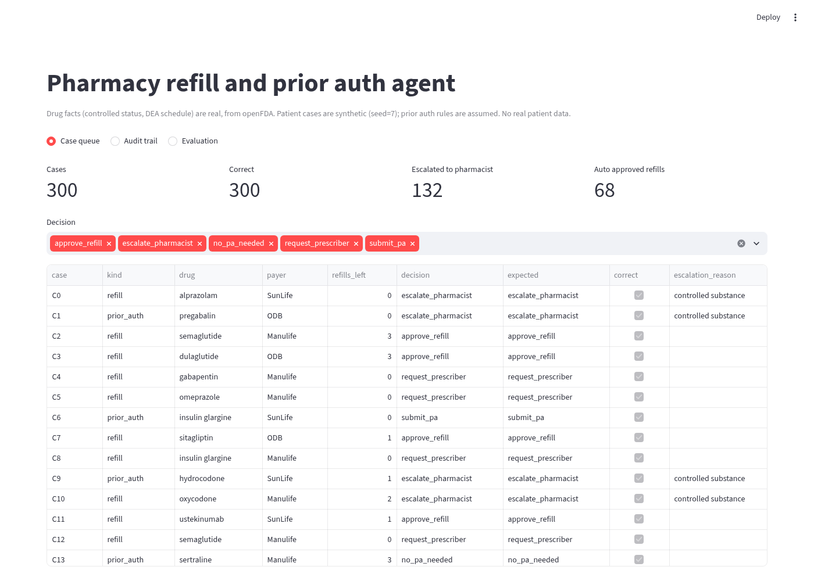
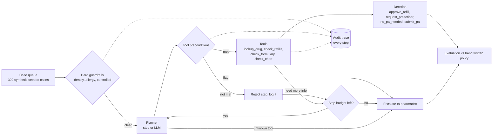
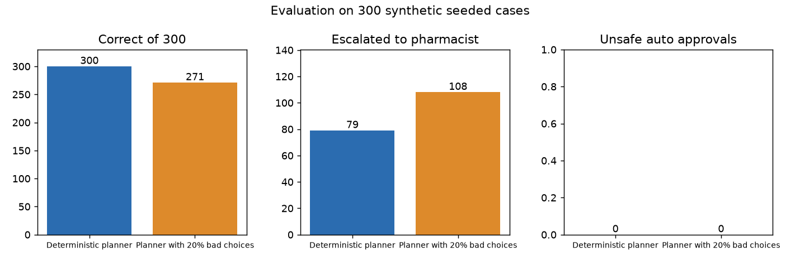
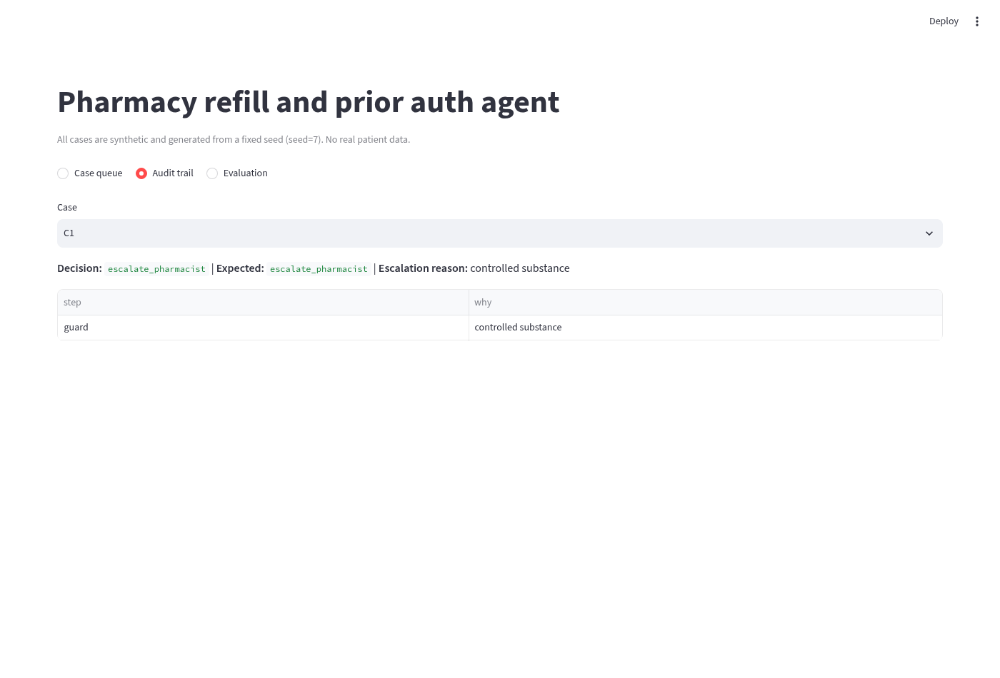
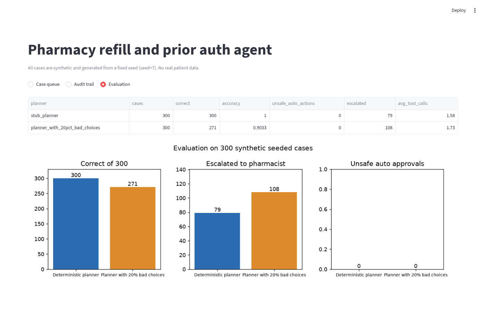

# Pharmacy refill and prior auth agent with guardrails

[](https://github.com/manishreddy998/pharmacy-refill-prior-auth-agent/actions/workflows/ci.yml)

An agent that handles routine pharmacy refills and prior authorizations, and sends anything risky to a pharmacist. Hard guardrails run before the planner, every tool has preconditions, and every step is written to an audit trail.

**All data is synthetic and generated from a fixed seed (seed=7).** No real patient data, payer API or LLM is used. Every run gives the same 300 cases and the same results.



## Why I built it

Refills and prior authorizations take a lot of pharmacy staff time, and most cases are routine. An agent can clear the routine ones, but it must never auto approve something a pharmacist has to see, such as a controlled substance, an allergy flag or a patient whose identity is not verified. I wanted to show that an agent can be built so that even when the model makes bad choices, the worst outcome is an extra escalation, never an unsafe approval.

## Architecture



The full walk through of components, data flow, guardrail order and the audit log is in [docs/architecture.md](docs/architecture.md).

## Results

Measured with `python -m rxagent.evaluate` on the 300 synthetic seeded cases. Raw output is in [results.json](results.json).

| Planner | Correct | Accuracy | Unsafe auto approvals | Escalated | Avg tool calls |
|---|---|---|---|---|---|
| Deterministic planner | 300 of 300 | 100% | 0 | 79 | 1.58 |
| Planner with 20% bad tool choices | 271 of 300 | 90.3% | 0 | 108 | 1.73 |



With bad tool choices the agent gets 29 more cases wrong, and all 29 are cases sent to a pharmacist that did not need to be (12 that should have gone back to the prescriber, 8 refills, 5 no prior auth needed and 4 prior auth submissions). None of them is an unsafe auto approval.

**What the eval caught.** The first noisy planner run crashed. A tool could run before the drug lookup, and a refill check could run on a prior auth case. Adding tool preconditions fixed both.

## Dashboard

`streamlit run dashboard/app.py` opens a light mode dashboard with three views.

**Case queue.** Every case with its decision, the expected answer and the escalation reason.


**Audit trail.** The step by step trace for one case.



**Evaluation.** The results table and chart.



## Design decisions and tradeoffs

| Decision | Why | Alternatives considered | Tradeoff |
|---|---|---|---|
| Guardrails in plain code before the planner | A model can never skip a safety check | Ask the LLM to check safety itself | Rules must be kept up to date by hand |
| Planner only picks a tool name | A model cannot write a decision directly, so a bad output stays contained | Let the model return the final decision | Less flexible for unusual cases |
| Preconditions on every tool | Turns out of order calls into logged rejections instead of crashes or wrong answers | Trust the planner's order | A few extra steps when the planner is wrong (1.73 vs 1.58 average calls) |
| Unknown tool and step budget both escalate | Fails safe when the model invents a tool or loops | Retry or ignore | More pharmacist work when the model misbehaves (108 vs 79 escalations) |
| Ground truth policy written apart from the agent | The agent is never graded against its own logic | Score against agent output | Two places to update when policy changes |
| Seeded synthetic data | Results repeat exactly and no patient data is needed | Real or de-identified records | Does not show real world messiness |
| Noisy planner in the eval | Tests the failure path, not only the happy path | Test only a good planner | Random noise is not the same as real LLM mistakes |

## Limits

- All data is synthetic and the policy is simplified to 7 drugs and 3 payers.
- The planner is a deterministic stub. No real LLM is called, so these numbers do not measure an LLM.
- No real payer, pharmacy system or prescriber API is called.
- The audit trail is kept in memory, not in a database.

## Next steps

- Put a real LLM behind the planner and run the same 300 cases.
- Store the audit trail in a database with case and user IDs.
- Add more drugs, payer rules and edge cases, such as early refills and duplicate therapy.
- Add a pharmacist review screen that records the final call and feeds it back into the eval.

## How to run

```bash
pip install -r requirements.txt
python -m pytest -q              # 5 tests, including a dashboard smoke test
python -m rxagent.evaluate       # prints the results above
python scripts/make_chart.py     # rebuilds docs/results_chart.png
streamlit run dashboard/app.py   # opens the dashboard on http://localhost:8501
```

## Project layout

```
rxagent/tools.py        synthetic pharmacy back end and ground truth policy
rxagent/agent.py        guardrails, planner and agent loop
rxagent/evaluate.py     300 case evaluation with normal and noisy planners
dashboard/app.py        Streamlit dashboard
scripts/make_chart.py   results chart from results.json
tests/                  guardrail, evaluation and dashboard tests
docs/                   architecture, screenshots and chart
```

## Author

Manish Reddy, [LinkedIn](https://linkedin.com/in/manish-re-50c02a719k), [GitHub](https://github.com/manishreddy998)
