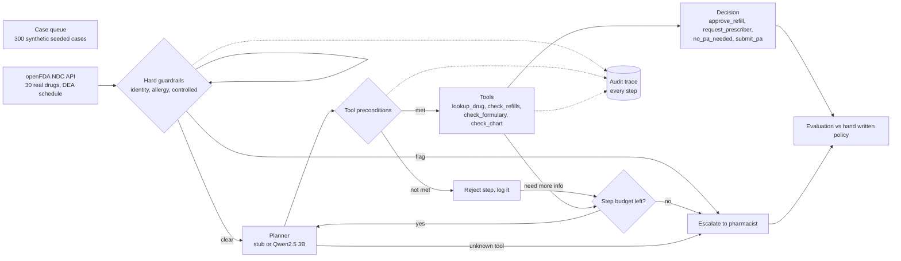

# Pharmacy refill and prior auth agent with guardrails

[](https://github.com/manishreddy998/pharmacy-refill-prior-auth-agent/actions/workflows/ci.yml)

An agent that handles routine pharmacy refills and prior authorizations, and sends anything risky to a pharmacist. Hard guardrails run before the planner, every tool has preconditions, and every step is written to an audit trail.

**Data.** Drug facts are real: controlled status and DEA schedule for 30 common generics come from the [openFDA NDC directory](https://open.fda.gov/apis/drug/ndc/) (US public domain), saved in `data/drugs_openfda.json` by `scripts/fetch_drugs.py`. Patient cases stay synthetic (seed=7) because real prescription records are protected health data; MIMIC style records need credentialed access. Prior auth flags are an assumed payer policy and are labelled `ASSUMED` in the JSON. A real local LLM (Qwen2.5 3B via Ollama) now runs as the planner.


## Why I built it

Refills and prior authorizations take a lot of pharmacy staff time, and most cases are routine. An agent can clear the routine ones, but it must never auto approve something a pharmacist has to see, such as a controlled substance, an allergy flag or a patient whose identity is not verified. I wanted to show that an agent can be built so that even when the model makes bad choices, the worst outcome is an extra escalation, never an unsafe approval.

## Architecture



The full walk through of components, data flow, guardrail order and the audit log is in [docs/architecture.md](docs/architecture.md).

## Results

Measured with `python -m rxagent.evaluate` (raw output in [results.json](results.json)). The Qwen planner ran on the first 100 cases because it takes about 3 to 5 seconds per step on CPU.

| Planner | Cases | Correct | Unsafe auto approvals | Escalated | Avg tool calls |
|---|---|---|---|---|---|
| Deterministic planner | 300 | 300 | 0 | 132 | 1.21 |
| Planner with 20% random bad choices | 300 | 277 | 0 | 155 | 1.26 |
| Deterministic planner | 100 | 100 | 0 | 49 | 1.08 |
| **Qwen2.5 3B planner** | 100 | **52** | **0** | 97 | 2.94 |


With real drug facts, 11 of the 30 drugs are controlled (CII to CV), so far more cases go to a pharmacist (132 of 300) than with the old 7 made up drugs (79).

**What the real LLM did.** Qwen got 52 of 100 right. All 48 misses were the same failure: it called `lookup_drug` again and again until the step budget ran out, so the case was escalated. It did not understand that the drug info was already in the state. That cost pharmacist time (97 escalations against 49), but the guardrails held: **0 unsafe auto approvals**. A clearer state message or a rule that blocks repeated tools would likely fix most of it; I have not tested that yet.

**What the eval caught earlier.** The first noisy planner run crashed. A tool could run before the drug lookup, and a refill check could run on a prior auth case. Adding tool preconditions fixed both.

## Dashboard

`streamlit run dashboard/app.py` opens a light mode dashboard with three views.

**Case queue.** Every case with its decision, the expected answer and the escalation reason.


**Audit trail.** The step by step trace for one case.


**Evaluation.** The results table and chart.


## Design decisions and tradeoffs

| Decision | Why | Alternatives considered | Tradeoff |
|---|---|---|---|
| Guardrails in plain code before the planner | A model can never skip a safety check | Ask the LLM to check safety itself | Rules must be kept up to date by hand |
| Planner only picks a tool name | A model cannot write a decision directly, so a bad output stays contained | Let the model return the final decision | Less flexible for unusual cases |
| Preconditions on every tool | Turns out of order calls into logged rejections instead of crashes or wrong answers | Trust the planner's order | A few extra steps when the planner is wrong (1.73 vs 1.58 average calls) |
| Unknown tool and step budget both escalate | Fails safe when the model invents a tool or loops | Retry or ignore | More pharmacist work when the model misbehaves (108 vs 79 escalations) |
| Ground truth policy written apart from the agent | The agent is never graded against its own logic | Score against agent output | Two places to update when policy changes |
| Real drug facts, synthetic patients | Drug safety facts are public; patient data is not | Fully synthetic, or credentialed clinical data | Patient mix is still made up |
| Noisy planner in the eval | Tests the failure path, not only the happy path | Test only a good planner | Random noise is not the same as real LLM mistakes |

## Limits

- Patient cases are synthetic and prior auth rules are assumed. Only the drug facts are real.
- Qwen was run on 100 of 300 cases.
- Controlled status is US federal (DEA). Ontario or Canadian schedules can differ.
- No real payer, pharmacy system or prescriber API is called.
- The audit trail is kept in memory, not in a database.

## Next steps

- Stop the repeated tool loop (block a tool that already ran) and rerun Qwen on all 300 cases.
- Use Health Canada Drug Product Database schedules for Canadian payers.
- Store the audit trail in a database with case and user IDs.
- Add more drugs, payer rules and edge cases, such as early refills and duplicate therapy.
- Add a pharmacist review screen that records the final call and feeds it back into the eval.

## How to run

```bash
pip install -r requirements.txt
python -m pytest -q              # 5 tests, including a dashboard smoke test
python scripts/fetch_drugs.py    # refresh real drug facts from openFDA (optional)
python -m rxagent.evaluate       # replays Qwen answers from data/llm_cache.json
LLM=ollama python -m rxagent.evaluate   # live Qwen, needs ollama with qwen2.5-3b
python scripts/make_chart.py     # rebuilds docs/results_chart.png
streamlit run dashboard/app.py   # opens the dashboard on http://localhost:8501
```

## Project layout

```
rxagent/tools.py        pharmacy back end (real openFDA drug facts, synthetic cases) and ground truth policy
rxagent/llm_planner.py  Qwen2.5 3B planner
scripts/fetch_drugs.py  openFDA fetch
rxagent/agent.py        guardrails, planner and agent loop
rxagent/evaluate.py     300 case evaluation with normal and noisy planners
dashboard/app.py        Streamlit dashboard
scripts/make_chart.py   results chart from results.json
tests/                  guardrail, evaluation and dashboard tests
docs/                   architecture, screenshots and chart
```

## Author

Manish Reddy, [LinkedIn](https://linkedin.com/in/manish-re-50c02a719k), [GitHub](https://github.com/manishreddy998)
