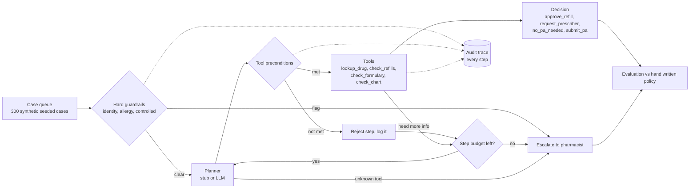

# Architecture

## Components

| Part | File | What it does |
|---|---|---|
| Pharmacy back end | `rxagent/tools.py` | 7 drugs with controlled and prior auth flags, and a case generator with a fixed seed (seed=7). Each case has a kind (refill or prior auth), drug, refills left, diagnosis on chart, allergy flag, date of birth (missing means identity not verified) and payer. |
| Ground truth policy | `expected()` in `rxagent/tools.py` | The right answer for each case, written by hand and kept apart from the agent code, so the agent is never graded against itself. |
| Agent loop | `rxagent/agent.py` | Runs guardrails, then asks the planner for one tool at a time until it reaches a decision. |
| Planner | `planner_stub` | Picks the next tool from what is known so far. In production this is where an LLM would sit. It can only pick a tool name, it can never write a decision directly. |
| Evaluation | `rxagent/evaluate.py` | Scores 300 cases with the normal planner and with a planner that picks a random wrong tool (including a fake `delete_record`) 20% of the time. |
| Dashboard | `dashboard/app.py` | Streamlit app with the case queue, each case's audit trail and the evaluation results. |

## Data flow

1. A case comes off the queue.
2. Hard guardrails run before any tool call. If one fires, the case goes to a pharmacist and the reason is logged.
3. Otherwise the planner picks a tool. The loop checks the tool's precondition. A tool that is not allowed yet is rejected and logged, and the loop moves on.
4. The tool runs and either returns a decision or adds facts to the state, such as the drug info or whether prior auth is needed.
5. If the planner names a tool that does not exist, or the step budget (6 steps) runs out, the case goes to a pharmacist.

## Guardrail order

Guardrails run in this order and stop at the first one that fires:

1. **Identity not verified** (no date of birth). Nothing should happen for an unknown patient.
2. **Allergy flag.** A pharmacist has to review it.
3. **Controlled substance.** These are never auto approved.

On the 300 seeded cases this sends 47 cases out for controlled substances, 17 for allergy flags and 15 for identity, 79 in total.

The guardrails are plain code, not model output, so a bad planner cannot skip them.

## Tool preconditions

| Tool | Allowed only when |
|---|---|
| `check_refills` | the case is a refill and the drug was looked up |
| `check_formulary` | the case is a prior auth and the drug was looked up |
| `check_chart` | the formulary said prior auth is needed |

## Audit log

Every step is added to a trace for the case: `guard` (with the reason), `tool` (with the tool name) and `reject` (with the tool name and why). The dashboard's Audit trail view shows this trace for any case, so a reviewer can see exactly why the agent did what it did.
